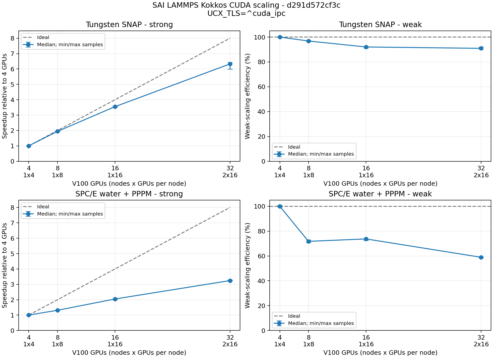

# SAI LAMMPS multi-node performance trial

Source: `d291d572cf3c73a8a720774b78482a7c931304ca`. Accepted site image with existing DeePMD integration; the binary reports `-modified`. No LAMMPS source changes were made for this experiment.

Slurm job `2340456`: `COMPLETED`, exit `0:0`, 00:29:30, 15.73 allocated GPU-hours. This includes reserved GPUs while smaller layouts run.

Explicit runtime settings: `{'UCX_TLS': '^cuda_ipc'}`.

One MPI rank per GPU, with the node layout recorded in the table, and one OpenMP thread per rank. MPI binds each rank to four physical cores, following the site's one-rank-per-GPU mapping. Three consecutive timed segments follow 100 warmup steps. Times exclude setup; full process wall times remain in the CSV and raw evidence. Nodes were not reserved exclusively.

Kokkos CUDA runs asynchronously. The raw Pair/Comm/etc. sections can charge GPU waits to a later section and must not be read as network-only or kernel-only costs. The LAMMPS Kokkos guide recommends CUDA_LAUNCH_BLOCKING=1 for accurate section timings; that diagnostic mode was not used here because it changes execution performance. The curves use complete loop times.

| Case | Atoms | Nodes x GPUs/node | Steps/sample | Median s | Min-max s | Strong speedup / weak efficiency |
|---|---:|---:|---:|---:|---:|---:|
| snap-strong-4gpu | 2097152 | 1x4 | 100 | 30.749 | 30.668-30.827 | 1.00x |
| snap-weak-4gpu | 524288 | 1x4 | 400 | 32.009 | 31.917-32.082 | 100.0% |
| snap-strong-8gpu | 2097152 | 1x8 | 100 | 15.834 | 15.818-15.848 | 1.94x |
| snap-weak-8gpu | 1048576 | 1x8 | 400 | 33.058 | 32.865-33.153 | 96.8% |
| snap-strong-16gpu | 2097152 | 1x16 | 100 | 8.663 | 8.629-8.709 | 3.55x |
| snap-weak-16gpu | 2097152 | 1x16 | 400 | 34.785 | 34.665-35.117 | 92.0% |
| snap-strong-32gpu | 2097152 | 2x16 | 100 | 4.859 | 4.790-5.128 | 6.33x |
| snap-weak-32gpu | 4194304 | 2x16 | 400 | 35.210 | 34.773-35.449 | 90.9% |
| spce-strong-4gpu | 972000 | 1x4 | 1250 | 42.610 | 42.408-42.817 | 1.00x |
| spce-weak-4gpu | 121500 | 1x4 | 5000 | 30.142 | 29.845-30.340 | 100.0% |
| spce-strong-8gpu | 972000 | 1x8 | 1250 | 32.458 | 32.451-32.616 | 1.31x |
| spce-weak-8gpu | 243000 | 1x8 | 5000 | 42.001 | 41.335-42.552 | 71.8% |
| spce-strong-16gpu | 972000 | 1x16 | 1250 | 20.823 | 20.734-21.220 | 2.05x |
| spce-weak-16gpu | 486000 | 1x16 | 5000 | 40.887 | 40.874-41.610 | 73.7% |
| spce-strong-32gpu | 972000 | 2x16 | 1250 | 13.134 | 12.956-13.165 | 3.24x |
| spce-weak-32gpu | 972000 | 2x16 | 5000 | 51.137 | 50.995-51.500 | 58.9% |

All 8 small-system CPU/GPU numerical checks passed. These compare initial and 10-step energy, pressure tensor and every atomic force. Large-system runs check atom counts, finite states, temperature bounds and initial potential energy across strong-scaling layouts (absolute tolerance 1e-6 per atom); they are performance trials, not converged production trajectories.

[Dashboard JSON](performance-summary.json) | [Full measurements](performance.json) | [CSV](table.csv) | [Slurm accounting](accounting.json) | [Raw evidence](raw.tar.gz) | [Hashes](manifest.json)

The existing upstream performance importer accepts the JSON. Its current display uses the best sample; this report uses medians and shows every sample range. These are adapted W SNAP and standard SPC/E inputs, not formal UK procurement results.

## Communication workaround and retained attempts

The default-transport full-node job was cancelled after water/PPPM became extremely slow. A full log audit found UCX errors in eight of its 12 completed timings and in all four water numerical gates. It is not a passed full experiment. This table uses only its four completed, error-free SNAP points whose CPU/GPU numerical checks passed. The paired run uses the same image, inputs, physical GPU UUIDs and CPU affinity, but excludes CUDA IPC. Measurement order and time differ, so this is diagnostic evidence, not a randomized causal trial.

| Completed point | Default median s | No CUDA IPC median s | Change |
|---|---:|---:|---:|
| snap-strong-4gpu | 30.684 | 30.749 | +0.2% |
| snap-weak-4gpu | 31.841 | 32.009 | +0.5% |
| snap-strong-8gpu | 15.792 | 15.834 | +0.3% |
| snap-weak-32gpu | 36.398 | 35.210 | -3.3% |

No reliable water overhead can be calculated from the default-transport timings: all completed default water points contain communication errors. Disabling the IPC mapping cache and forcing whole allocation registration each reproduced UCX errors in isolated probes. Excluding the CUDA IPC transport completed the isolated 16-GPU water test and the final full matrix.

No SIF, application binary, system MPI installation or public module was changed. The workaround is an explicit job environment setting; GPU calculation remains enabled.

The earlier [four-GPU-per-node report](../20261110/README.md) from job `2338108` also contains UCX errors in 13 of 28 case logs, including four numerical gates. Its original success verdict is withdrawn. The input decks, models, image, source and host MPI match this rerun, but it is not an accepted scaling baseline. This report does not attribute the difference between those runs to node packing or quantify the isolated cost of disabling CUDA IPC.

The tested nodes contain four separate four-GPU NVLink groups. The launcher selects GPUs by CPU locality rather than assuming full-node GPU indices follow CPU core order. Every GPU rank has four physical CPU cores with disjoint affinity and a unique GPU UUID; the two-node cases use all 32 physical GPUs. See [placement validation](placement-validation.json).

All attempts in this follow-up used **33.11 allocated GPU-hours**, including cancelled runs, failed probes and reserved GPUs during smaller layouts.

| Job | Run | State | Elapsed | Allocated GPU-hours |
|---|---|---|---:|---:|
| 2339338 | topology-20261110-a ([raw](attempts/topology-20261110-a.tar.gz)) | CANCELLED by 1478400690 | 00:03:59 | 2.12 |
| 2339398 | topology-20261110-b ([raw](attempts/topology-20261110-b.tar.gz)) | CANCELLED by 1478400690 | 00:26:27 | 14.11 |
| 2340257 | ipc-cache-off-20261110-a ([raw](attempts/ipc-cache-off-20261110-a.tar.gz)) | FAILED | 00:00:57 | 0.25 |
| 2340369 | ipc-whole-20261110-a ([raw](attempts/ipc-whole-20261110-a.tar.gz)) | FAILED | 00:00:54 | 0.24 |
| 2340370 | ipc-disabled-20261110-a ([raw](attempts/ipc-disabled-20261110-a.tar.gz)) | COMPLETED | 00:02:27 | 0.65 |
| 2340456 | topology-noipc-20261110-a ([raw](raw.tar.gz)) | COMPLETED | 00:29:30 | 15.73 |

[Diagnostic data and accounting](diagnostics.json). The raw archives retain failed/cancelled status and operator explanations. [UCX PR #11216](https://github.com/openucx/ucx/pull/11216) addresses the same error class; its patch was not applied or tested here.
