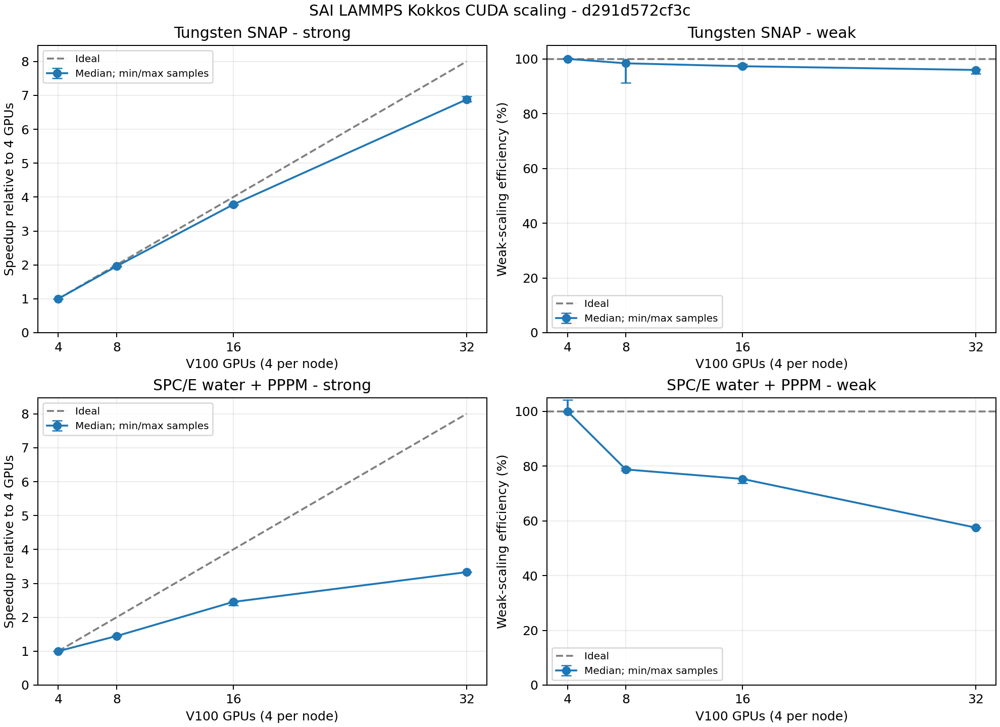

# SAI LAMMPS multi-node performance trial

Source: `d291d572cf3c73a8a720774b78482a7c931304ca`. Accepted site image with existing DeePMD integration; the binary reports `-modified`. No LAMMPS source changes were made for this experiment.

Slurm job `2338108`: `COMPLETED`, exit `0:0`, 00:23:43, 12.65 allocated GPU-hours. This includes reserved GPUs while smaller layouts run.

One MPI rank per GPU, four GPUs per node, one OpenMP thread per rank. MPI binds each rank to four physical cores, following the site's one-rank-per-GPU mapping. Three consecutive timed segments follow 100 warmup steps. Times exclude setup; full process wall times remain in the CSV and raw evidence. Nodes were not reserved exclusively.

Kokkos CUDA runs asynchronously. The raw Pair/Comm/etc. sections can charge GPU waits to a later section and must not be read as network-only or kernel-only costs. The LAMMPS Kokkos guide recommends CUDA_LAUNCH_BLOCKING=1 for accurate section timings; that diagnostic mode was not used here because it changes execution performance. The curves use complete loop times.

| Case | Atoms | GPUs | Steps/sample | Median s | Min-max s | Strong speedup / weak efficiency |
|---|---:|---:|---:|---:|---:|---:|
| snap-strong-4gpu | 2097152 | 4 | 100 | 30.801 | 30.741-30.848 | 1.00x |
| snap-weak-4gpu | 524288 | 4 | 400 | 31.977 | 31.900-31.984 | 100.0% |
| snap-strong-8gpu | 2097152 | 8 | 100 | 15.716 | 15.713-15.787 | 1.96x |
| snap-weak-8gpu | 1048576 | 8 | 400 | 32.503 | 32.456-35.025 | 98.4% |
| snap-strong-16gpu | 2097152 | 16 | 100 | 8.149 | 8.140-8.184 | 3.78x |
| snap-weak-16gpu | 2097152 | 16 | 400 | 32.859 | 32.618-32.972 | 97.3% |
| snap-strong-32gpu | 2097152 | 32 | 100 | 4.478 | 4.418-4.514 | 6.88x |
| snap-weak-32gpu | 4194304 | 32 | 400 | 33.324 | 33.194-33.793 | 96.0% |
| spce-strong-4gpu | 972000 | 4 | 1250 | 30.703 | 30.598-30.953 | 1.00x |
| spce-weak-4gpu | 121500 | 4 | 5000 | 21.199 | 20.333-21.244 | 100.0% |
| spce-strong-8gpu | 972000 | 8 | 1250 | 21.220 | 21.145-21.338 | 1.45x |
| spce-weak-8gpu | 243000 | 8 | 5000 | 26.918 | 26.734-27.037 | 78.8% |
| spce-strong-16gpu | 972000 | 16 | 1250 | 12.515 | 12.482-13.085 | 2.45x |
| spce-weak-16gpu | 486000 | 16 | 5000 | 28.154 | 28.116-28.754 | 75.3% |
| spce-strong-32gpu | 972000 | 32 | 1250 | 9.215 | 9.214-9.220 | 3.33x |
| spce-weak-32gpu | 972000 | 32 | 5000 | 36.865 | 36.833-36.890 | 57.5% |

All 8 small-system CPU/GPU numerical checks passed. These compare initial and 10-step energy, pressure tensor and every atomic force. Large-system runs check atom counts, finite states, temperature bounds and initial potential energy across strong-scaling layouts (absolute tolerance 1e-6 per atom); they are performance trials, not converged production trajectories.

[Dashboard JSON](performance-summary.json) | [Full measurements](performance.json) | [CSV](table.csv) | [Slurm accounting](accounting.json) | [Raw evidence](raw.tar.gz) | [Hashes](manifest.json)

The existing upstream performance importer accepts the JSON. Its current display uses the best sample; this report uses medians and shows every sample range. These are adapted W SNAP and standard SPC/E inputs, not formal UK procurement results.

The earlier two-node [pilot measurements](pilot-performance.json) and [pilot raw evidence](pilot-raw.tar.gz) selected the sizes and step counts. [All attempt accounting](attempt-accounting.json) includes the two early harness failures. Total allocation, including the pilot and those failures, was 13.06 GPU-hours.
